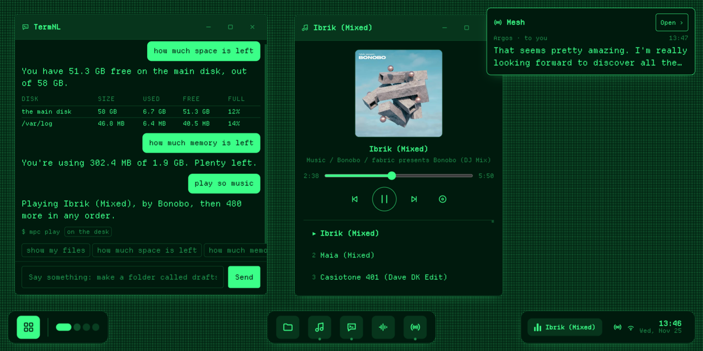

# SymbiOS

A symbiotic operating system for small boards. The board brings the mind: your files, your notes, your music, your
voice memos, and plain words to run the machine. The screen it is plugged into lends the body: an HDMI screen, a
laptop over a USB cable, your phone. Your files stay on the board: no account, no cloud service, no large model.



*SymbiOS on an Orange Pi Zero 2W.*

> **An early preview, for builders.** It runs every day on two boards, and it is still young: installing takes a
> laptop, SSH and about an hour. Read "Known limits" before you put your own files on it.
>
> **This guide is being tested from a blank card; until then, expect rough edges.**

## What is inside

| Folder | What it is |
|---|---|
| `termnl/` | **TermNL**, the foundation: you talk to the board in plain sentences ("how much space is left", "play some music", "what is plugged into the USB"). It only ever runs the commands written in its skill files, asks before anything risky, and runs offline. Its own project: [TermNL](https://github.com/msieur-gab/TermNL). |
| `desk/` | **The desk**, the face: a desktop in the browser with Files, Memos (voice memos turned into text on the board), a music Player, Slides, a Reader, search by meaning, Mesh (a Meshtastic radio on USB) and TermNL in a window. The only program that listens on the network. |
| `companion/` | **The companion**, your phone's page: the key that claims the board, the remote, and the same apps in your pocket. A web page you host yourself (below). |
| `board/` | **The installers**: the base system, TermNL as a service on a local socket, the desk on top. |

## Boards

| Board | State |
|---|---|
| **Orange Pi Zero 2W** (2 GB), Armbian | the main board: HDMI kiosk, sound, Bluetooth, the USB cable to a phone or a laptop. Guide below. |
| **Luckfox Lyra Zero W** (464 MB), Luckfox's Ubuntu image | runs it all, slower; no screen, no sound, WiFi or Bluetooth but not both (a limit of its chip). For the adventurous: `board/lyra/README.md`. |
| **Raspberry Pi** | not yet: it is next. |

You also need a microSD card (16 GB or more), a laptop running Linux with a card reader, a USB-C cable that carries
data, and an **Android phone with Chrome** (iPhones are not tested yet).

## The companion: host your own

Your phone keeps the key that owns your board, inside the companion page. The key never leaves the phone, but
whoever controls the site that serves the page controls what can use that key. So each person hosts their own copy,
at an address of its own, over HTTPS (a phone only installs a page from there):

- **Netlify Drop**, the quickest: drag the `companion/` folder onto [app.netlify.com/drop](https://app.netlify.com/drop)
  and keep the address it gives you (`https://<name>.netlify.app`).
- **Cloudflare Pages** works the same way.
- **GitHub Pages**, only on an account that publishes nothing else: every Pages site of an account shares one address
  (`https://<you>.github.io`), so any of them could use your key.

Never delete that site while your board names it: someone else could take the freed name.

## Installing on an Orange Pi Zero 2W

Everything below is run from the laptop, in this folder.

1. **The card, the WiFi, the first login and the base layer**: follow `board/README.md`, steps 1 to 5. The card is
   written with your WiFi and your SSH key on it; SSH then takes keys only, a firewall leaves only SSH and the desk
   open on the WiFi, and security updates install themselves. The image is the one SymbiOS was tested on, Armbian
   community `26.11.0-trunk.83`: download it from this repository's
   [release](https://github.com/msieur-gab/symbios/releases/tag/v0.1) (Armbian no longer offers it);
   `write-card.sh` checks it before writing.
2. **TermNL**:
   ```
   ssh <user>@<address> mkdir -p symbios-src
   rsync -a --delete termnl/ <user>@<address>:symbios-src/termnl/
   rsync -a board/ <user>@<address>:symbios-board/
   ssh -t <user>@<address> sudo symbios-board/install-termnl.sh symbios-src/termnl
   ssh <user>@<address> termnl how much space is left
   ```
3. **The desk**, with your companion's address:
   ```
   rsync -a --delete desk/ <user>@<address>:symbios-src/desk/
   ssh -t <user>@<address> sudo COMPANION=https://<your companion> symbios-board/install-desk.sh symbios-src/desk
   ```
   It installs the kiosk browser and downloads the speech and search models (about 300 MB, from their own
   sources), so give it time. Run it again to update; the address is remembered. The same models are kept in the
   release too, in case a source vanishes.
4. **Claim it.** The board's HDMI screen, or a laptop's browser on the USB cable at `http://10.55.0.1`, shows a QR
   code. Scan it with the phone: it opens your companion, which claims the board. From then on the board answers
   your phone only, and every screen stays locked until your phone allows it. `desk/FIRST-USE.md` tells the rest:
   the secret word that takes the board back if you lose your phone, and giving it a WiFi (it still describes the
   older claim with the phone on the cable, which also works on the Orange Pi).

## Known limits

- **Claim it at home**, on a network you trust, with no other site open in the laptop's browser on the cable. The QR
  claim isn't bound to your phone's key yet: someone on the same WiFi at that very moment could get in between.
- **The SD card is not encrypted, on purpose**: if you lose your phone, you can still read your files in any card
  reader. The same goes for a stolen board: anyone with the card can read it. If it is lost, release it from your
  phone.
- The board's user can still become root with its password; the programs themselves are installed read-only, and
  TermNL only runs what its skill files allow.
- Mesh stops until the desk restarts if a malformed packet arrives from the mesh.
- The installers download what they need from Debian, PyPI, GitHub and Hugging Face; the board image and the
  models are kept in the release, in case those sources change.
- A deploy guide for the Lyra in this repository's layout, a one-command install and ready-made card images are to
  come.

## Credits and licence

SymbiOS stands on the work of many people: NVIDIA's Parakeet and sherpa-onnx for speech, MiniLM for search, xterm.js,
marked, Meshtastic's message format, Armbian, Debian and more. All are named in [NOTICE.md](NOTICE.md).

Copyright © 2026 Gabriel Baude. Free software under the [GPL-3.0](LICENSE), with two additional terms
([NOTICE.md](NOTICE.md)): copies keep "Originally made by Gabriel Baude" with a link here, and a changed version
carries another name (it may say "based on SymbiOS"). Get in touch through [thecu.be](https://thecu.be).

`VERSIONS` says which version of each part this release holds.
